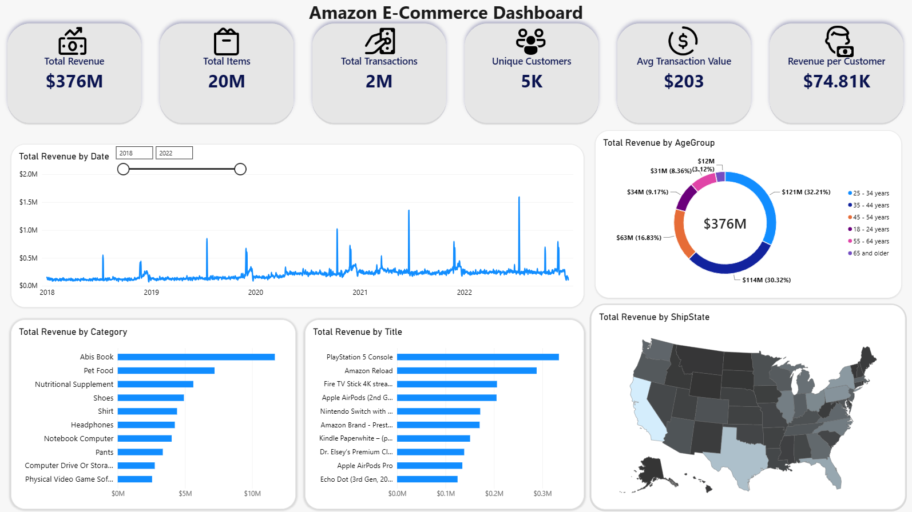
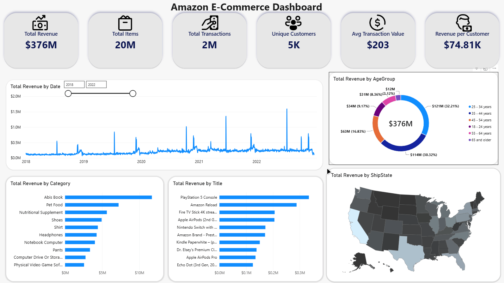
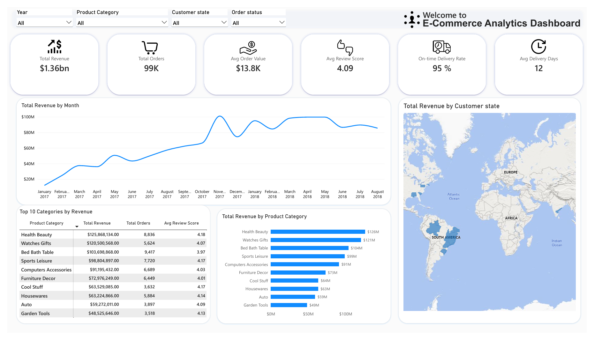
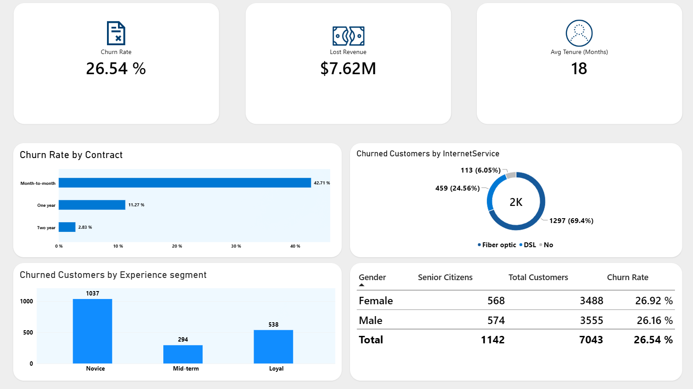
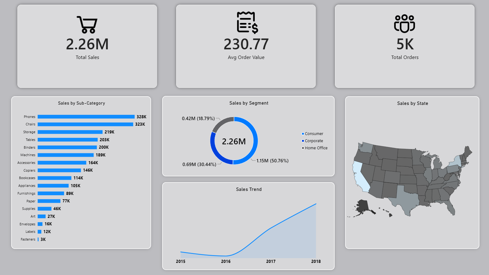
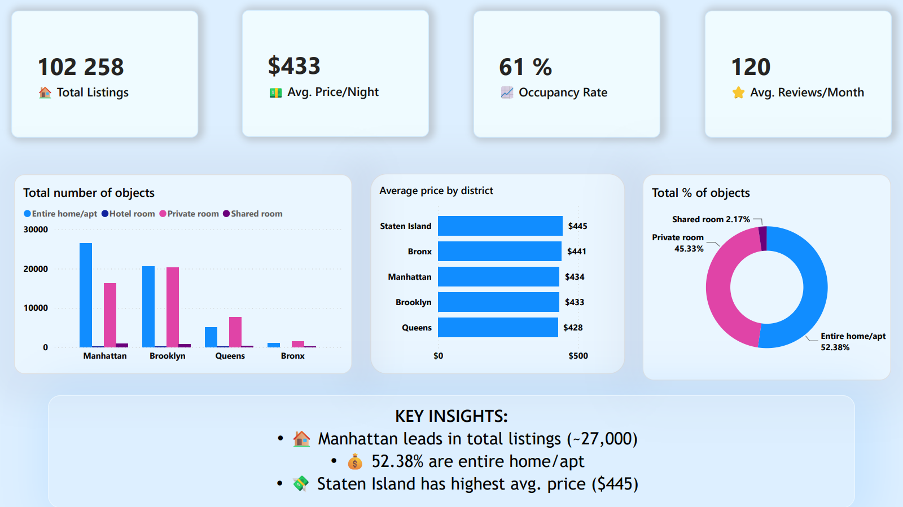
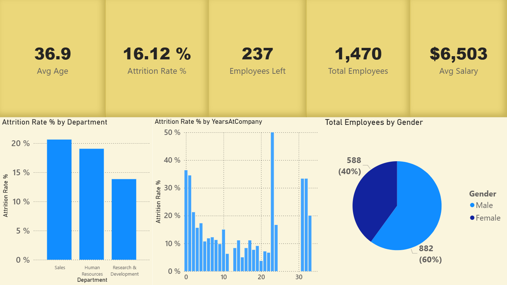
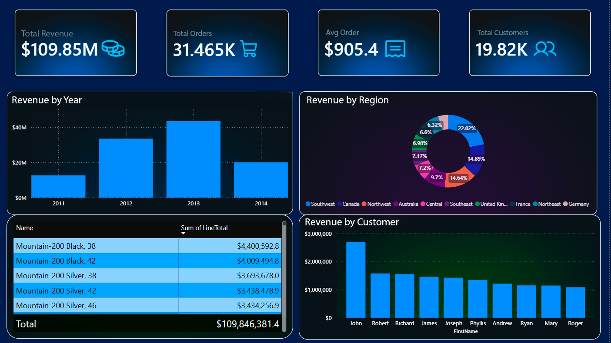
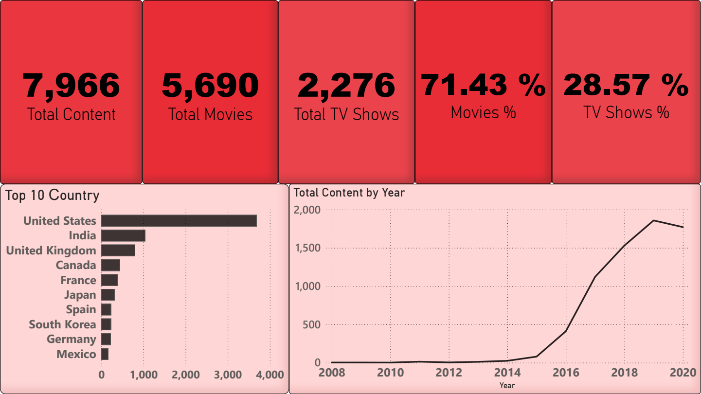

# 🛍️ Amazon E-Commerce Analytics Dashboard (Power BI)
##### [← Back to portfolio](../README.md) | [Переключить на русский](README_RU.md)



## 🇬🇧 About the Project

An interactive Power BI dashboard analyzing consumer behavior on Amazon: revenue dynamics, top categories and products, customer demographics, and shipping geography.

### 🎯 Business Task

**Context:** Amazon is the world's largest marketplace. The dataset covers the period from 2018 to 2022 (≈2M transactions, ≈5K unique users).
**Task:** Create a single monitoring window answering the following questions:
- How does revenue and the number of transactions change over the years?
- Which products and categories generate the maximum income?
- Which demographic group (age) is the primary target audience?
- How are sales distributed across US states?

**Business Value:** Understanding seasonality (peaks on Black Friday and Prime Day), identifying the most profitable products, and defining the portrait of a typical buyer for targeted advertising setup.

## 🛠️ Tools

- Power BI Desktop
- DAX (measures, SUMX iterators, filter context)
- Power Query (handling missing values, converting cents to dollars)
- CSV (3 dataset files from Amazon)

## What I Did

### 1. Data Preparation (Power Query)
- Loaded 3 files: `amazon-purchases.csv`, `survey.csv` (demographics), `fields.csv` (dictionary).
- **Price Handling:** Source prices were stored in cents (e.g., 13999 = $139.99). Created a calculated column dividing by 100 and set the data type to `Decimal Number`.
- **Missing Values:** Blank categories and states were filled as `Other` and `Digital / no state` to avoid losing transactions.
- **Optimization:** Removed the text column `Title` (product names) from the fact table and moved it to a separate `Dim_Product` dimension to reduce the `.pbix` file size.
- Model relationships (star schema):
  - `amazon-purchases[RespondentID]` → `survey[RespondentID]` (*:1)
  - `amazon-purchases[Date.OrderPurchase]` → `Calendar[Date]` (*:1)
  - `amazon-purchases[ASIN]` → `Dim_Product[ASIN]` (*:1)

### 2. Calendar Table
```dax
Calendar = CALENDAR(DATE(2018,1,1), DATE(2022,12,31))
```
Columns: `Year`, `Month`, `MonthKey`, `Quarter`. `Month` is sorted by `MonthKey` for correct chronological display on charts.

### 3. DAX Measures (`_Measures` table)

**Total Revenue**
```dax
Total Revenue = SUMX('amazon-purchases', 'amazon-purchases'[PriceUsd] * 'amazon-purchases'[Quantity])
```
**Total Items**
```dax
Total Items = SUM('amazon-purchases'[Quantity])
```
**Total Transactions**
```dax
Total Transactions = COUNTROWS('amazon-purchases')
```
**Unique Customers**
```dax
Unique Customers = DISTINCTCOUNT('amazon-purchases'[RespondentID])
```
**Avg Transaction Value**
```dax
Avg Transaction Value = DIVIDE([Total Revenue], [Total Transactions])
```
**Revenue per Customer**
```dax
Revenue per Customer = DIVIDE([Total Revenue], [Unique Customers])
```
**Max Price**
```dax
Max Price = MAX('amazon-purchases'[PriceUsd])
```

### 4. Visualization
- **KPI Cards** (6) — Total Revenue, Total Items, Total Transactions, Unique Customers, Avg Transaction Value, Revenue per Customer with icons.
- **Line Chart** — revenue dynamics by date, displaying seasonal peaks.
- **Bar Chart** — top-10 categories and top-10 products by revenue (Gift Cards and blank titles excluded for clean physical retail analytics).
- **Donut Chart** — revenue distribution by age groups.
- **Map** — revenue distribution by shipping states.
- **Slicer** — filter by year (2018–2022).

### 5. Design
- Background `#FAFAFA`, cards `#E6E6E6` with rounded corners, dark blue accents.
- Single font (Segoe UI), hidden axes, and grids on charts for a clean look.
- Canvas title: "Amazon E-Commerce Dashboard".



## 📈 Key Insights

- **Revenue:** $376M for the period, ≈2M transactions from 5K customers.
- **Average Transaction Value:** $203. This high figure is due to the fact that in the source dataset, the quantity of items (`Quantity`) is fixed at 10 for each transaction.
- **Seasonality:** Clear peaks in November-December (Black Friday, Christmas) and July (Prime Day).
- **Top Categories:** Books, Pet Food, Nutritional Supplements.
- **Top Products:** PlayStation 5, Amazon Reload, Fire TV Stick, Apple AirPods.
- **Demographics:** The main revenue (32%) comes from customers aged 25–34.
- **Geography:** Revenue leaders are California, Texas, and New York.

## 💡 Recommendations

1. **Assortment:** Focus the marketing budget on top categories (Books, Pet Food, Electronics).
2. **Seasonality:** Increase inventory and launch ad campaigns 2-3 weeks before July and November.
3. **Demographics:** Set up targeting for the 25–34 age audience — this is the most solvent group in the sample.

## 📂 Dataset

**Source:** [Amazon Open E-Commerce 1.0 (Nature Scientific Data)](https://dataverse.harvard.edu/dataset.xhtml?persistentId=doi:10.7910/DVN/YGLYDY)


**File:** [📥 Download .pbix file](https://github.com/Mangil123123/portfolio/releases/download/v1.00/amazon.pbix) (Power BI Desktop required)

## 🗂️ Other Projects

| | | |
|---|---|---|
| <a href="../Olist_Ecommerce/README.md"></a> | <a href="../Telco_Churn/README.md"></a> | <a href="../Superstore/README.md"></a> |
| **Olist E-Commerce** | **Telco Churn** | **Superstore** |
| Brazilian e-commerce | Telecom churn analysis | Retail sales analytics |

| | | |
|---|---|---|
| <a href="../Airbnb_NYC/README.md"></a> | <a href="../HR_Employee_Attrition/README.md"></a> | <a href="../AdventureWorks_Sales_Dashboard/README.md"></a> |
| **Airbnb NYC** | **HR Analytics** | **AdventureWorks Sales** |
| Short-term rental market | Employee attrition | Bike retail sales analysis |

| |
|---|
| <a href="../Netflix_analysis/README.md"></a> |
| **Netflix Analysis** |
| Netflix content analysis |

[← Back to portfolio](../README.md)
