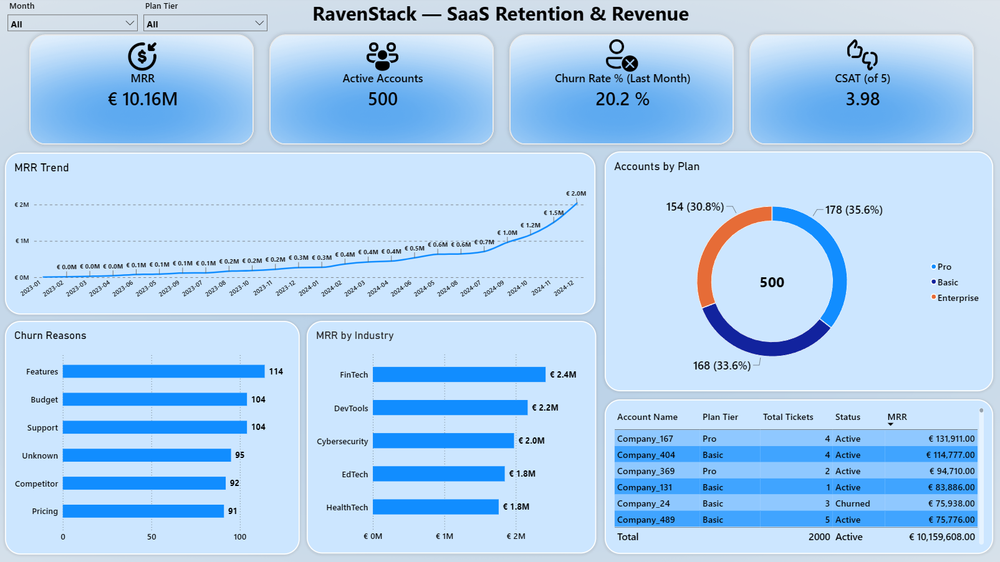
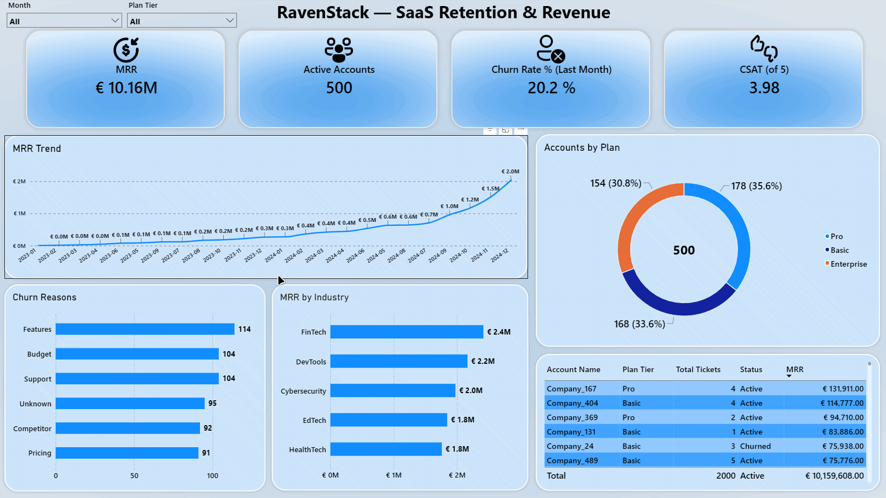
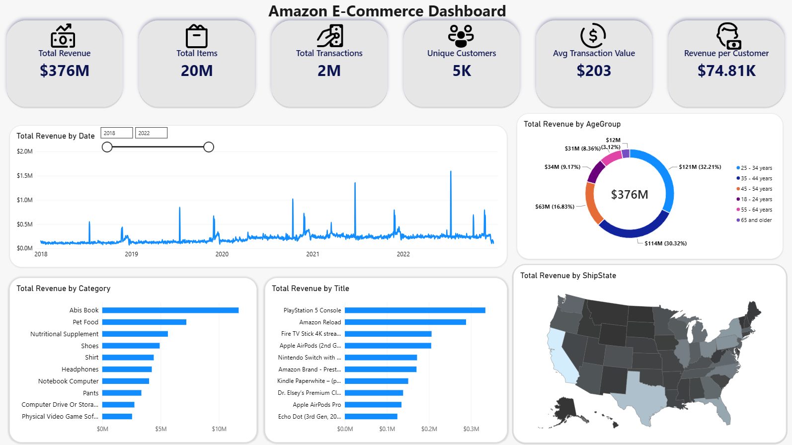
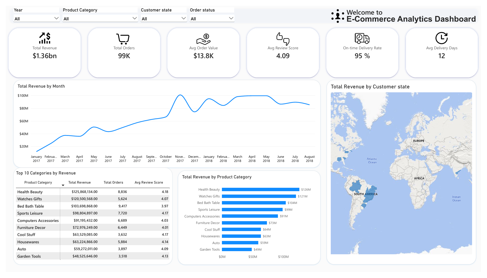
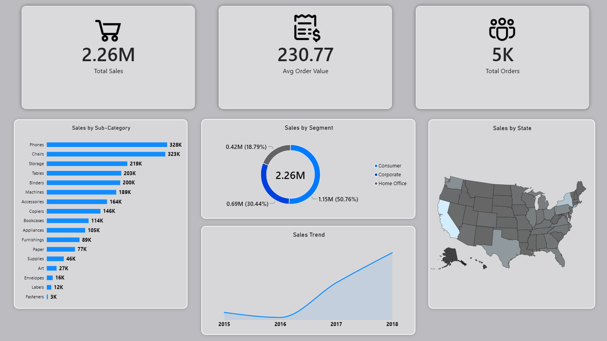
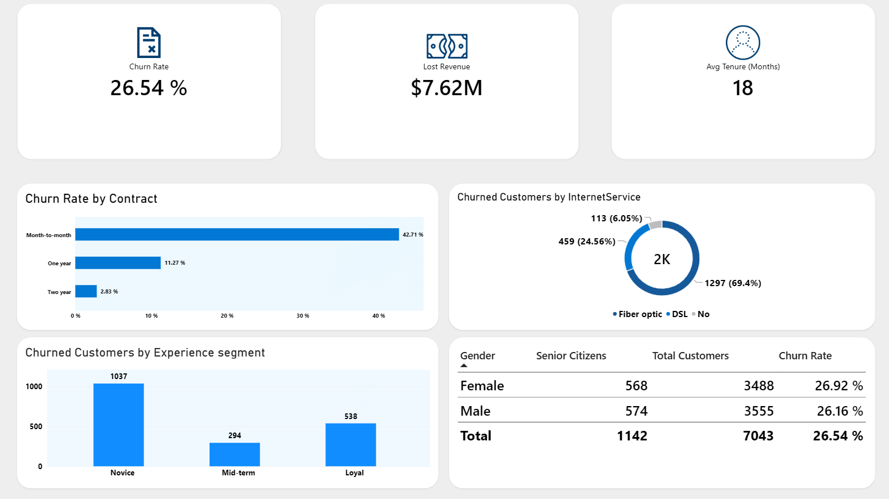
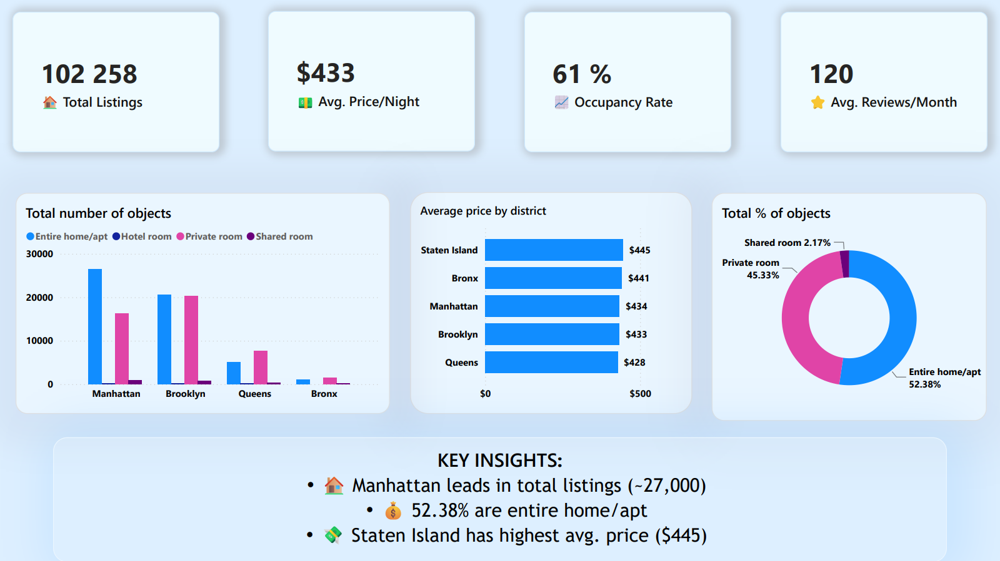
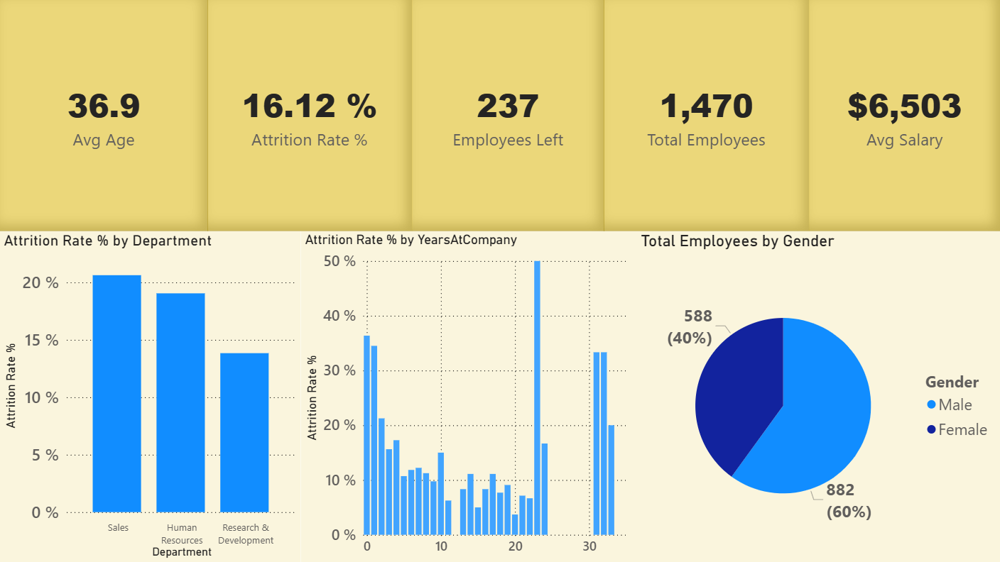
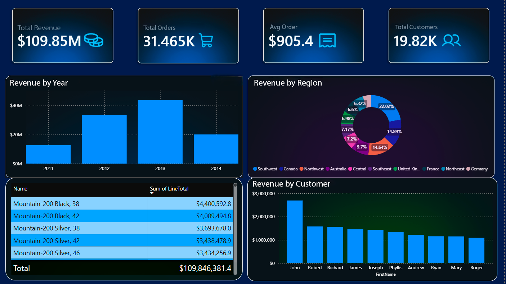
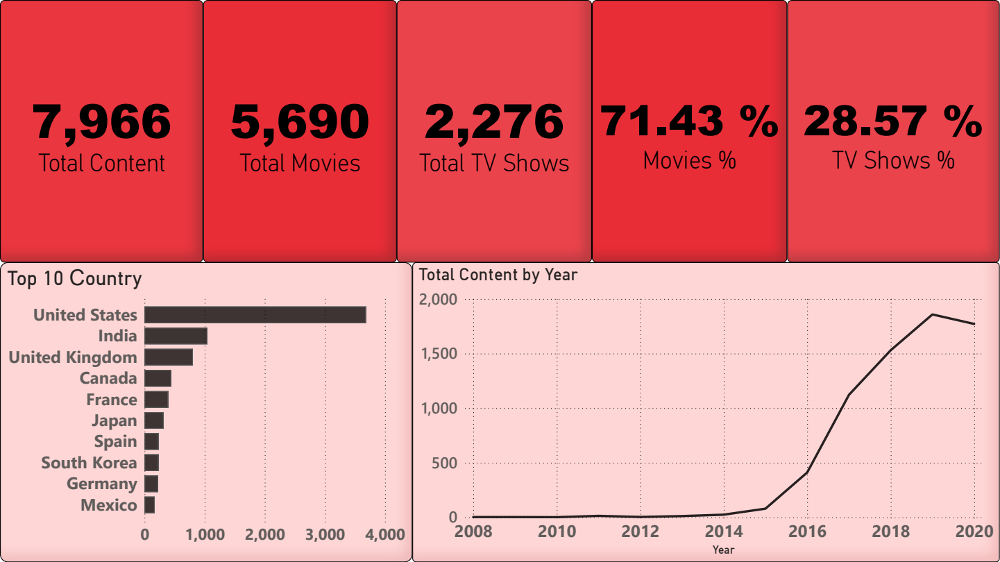

# 📈 RavenStack — SaaS Retention & Revenue Dashboard
##### [← Back to portfolio](../README.md) | [Переключить на русский](README_RU.md)



## About the Project

Power BI dashboard for B2B SaaS retention and revenue analytics, built on a 5-table relational model (star schema): subscription revenue, churn drivers, support quality and account-level detail.

### 🎯 Business Task

**Context:** RavenStack is a B2B SaaS platform: 500 customer accounts, 5,000 subscription records, 25,000 feature-usage events, 2,000 support tickets and 600 churn events over 2023–2025. Monthly recurring revenue is growing (€10.16M MRR), while monthly churn is 20.2% (December 2024) and 352 of 500 accounts (70%) passed through churn over the whole period — the company grows on acquisition, not on retention.
**Task:** Build a single retention cockpit answering:

- What is the revenue base (MRR) and how does it trend by month?
- How many accounts leave per month, and why?
- Which plan tiers and industries carry the revenue?
- Are we servicing customers well — what is our CSAT?

**Business value:** Revenue growth hides a retention leak. Putting MRR and churn on one screen makes the gap visible instead of hiding it behind a single flattering KPI.

## 🛠️ Tools

- Power BI Desktop
- DAX
- Power Query
- CSV (5 source tables)

## What I Did

### 1. Data Preparation

- Loaded five CSVs into a business-named model: `Accounts` (500), `Subscriptions` (5,000), `FeatureUsage` (25,000), `SupportTickets` (2,000), `ChurnEvents` (600).
- Fixed locale breakage at the source: decimal columns (`satisfaction_score`, `resolution_time_hours`, `mrr_amount`, `refund_amount_usd`) were re-imported with **Changed Type with Locale** (en-US) — this turned a broken CSAT metric into the real **3.98 / 5**.
- Neutralized the classic MRR trap: `Subscriptions` is a plan-change history (~10 rows per account), so a plain `SUM(mrr_amount)` counts every customer ~10 times. Null `end_date` was replaced with a `#date(2099,12,31)` sentinel so open-ended active subscriptions stay filterable by period.
- Anonymized customers in Power Query: original company names were replaced with `Company_1 … Company_500` via an index column (`"Company_" & Text.From(Index)`).
- `ChurnEvents` cleanup: empty `feedback_text` → `No feedback`; `reason_code` capitalized with `Text.Proper` for readable bars.
- Business-language renames (`plan_tier` → `Plan Tier`, `account_name` → `Account Name`) were done in the Data pane / Model view, not in M; the raw `churn_flag` column was never surfaced to report users.

### 2. Data Model

**Star schema:** dimension `Accounts` and a DAX-built `DimDate` (`CALENDAR(2023-01-01, 2025-12-31)` with Year / Month / Quarter / IsCurrentMonth); facts `Subscriptions`, `FeatureUsage`, `SupportTickets`, `ChurnEvents`. `Accounts → SupportTickets / ChurnEvents / Subscriptions` are active 1-to-many on `account_id`; `FeatureUsage` chains to accounts through `subscription_id`. All measures live in a dedicated `_Measures` table.

### 3. DAX Measures

**MRR** — recurring revenue from subscriptions active at the end of the selected period:

```dax
MRR =
CALCULATE (
    SUM ( 'Subscriptions'[mrr_amount] ),
    FILTER (
        'Subscriptions',
        'Subscriptions'[start_date] <= MAX ( 'DimDate'[Date] )
            && 'Subscriptions'[end_date] >= MAX ( 'DimDate'[Date] )
    )
)
```

**Active Accounts**

```dax
Active Accounts =
CALCULATE(
    DISTINCTCOUNT('Subscriptions'[account_id]),
    FILTER(
        'Subscriptions',
        'Subscriptions'[start_date] <= MAX('DimDate'[Date]) &&
        'Subscriptions'[end_date] >= MAX('DimDate'[Date])
    )
)
```

**Churn Rate % (Last Month)** — monthly churn: accounts that left in the selected month divided by the accounts active on the 1st of that month. If the selected period is empty, the measure falls back to the last month with data (December 2024):

```dax
Churn Rate % (Last Month) =
VAR MaxDateCtx = MAX ( 'DimDate'[Date] )
VAR CtxStart = EOMONTH ( MaxDateCtx, -1 ) + 1
VAR CtxEnd = EOMONTH ( MaxDateCtx, 0 )
VAR ChurnedCtx =
    CALCULATE (
        DISTINCTCOUNT ( 'ChurnEvents'[account_id] ),
        REMOVEFILTERS ( 'DimDate' ),
        'ChurnEvents'[churn_date] >= CtxStart,
        'ChurnEvents'[churn_date] <= CtxEnd
    )
VAR MaxChurnDate =
    CALCULATE ( MAX ( 'ChurnEvents'[churn_date] ), ALL ( 'DimDate' ) )
VAR LastStart = EOMONTH ( MaxChurnDate, -1 ) + 1
VAR LastEnd = EOMONTH ( MaxChurnDate, 0 )
VAR UseFallback = ISBLANK ( ChurnedCtx ) || ChurnedCtx = 0
VAR MonthStart = IF ( UseFallback, LastStart, CtxStart )
VAR Churned =
    IF (
        UseFallback,
        CALCULATE (
            DISTINCTCOUNT ( 'ChurnEvents'[account_id] ),
            REMOVEFILTERS ( 'DimDate' ),
            'ChurnEvents'[churn_date] >= LastStart,
            'ChurnEvents'[churn_date] <= LastEnd
        ),
        ChurnedCtx
    )
VAR ActiveStart =
    CALCULATE (
        DISTINCTCOUNT ( 'Subscriptions'[account_id] ),
        FILTER (
            ALL ( 'Subscriptions' ),
            'Subscriptions'[start_date] <= MonthStart &&
            'Subscriptions'[end_date] >= MonthStart
        )
    )
RETURN
    DIVIDE ( Churned, ActiveStart, 0 )
```

**Churn Count by Reason**

```dax
Churn Count by Reason = COUNTROWS ( 'ChurnEvents' )
```

**Status** — readable account status instead of a raw TRUE/FALSE flag:

```dax
Status =
VAR Flag = SELECTEDVALUE ( 'Accounts'[churn_flag] )
RETURN
    IF ( Flag = TRUE, "Churned", "Active" )
```

**CSAT (of 5)**

```dax
CSAT (of 5) = AVERAGE ( 'SupportTickets'[satisfaction_score] )
```

**Total Tickets**

```dax
Total Tickets = COUNTROWS ( 'SupportTickets' )
```

**Avg Resolution Hours** — average ticket resolution time, kept in the model for per-account service-quality analysis:

```dax
Avg Resolution Hours = AVERAGE ( 'SupportTickets'[resolution_time_hours] )
```

**Escalation Rate %** — share of escalated tickets, kept in the model for per-account churn-risk analysis:

```dax
Escalation Rate % =
VAR Escalated =
    CALCULATE (
        COUNTROWS ( 'SupportTickets' ),
        FILTER (
            'SupportTickets',
            LOWER ( TRIM ( 'SupportTickets'[escalation_flag] & "" ) )
                IN { "1", "true", "yes", "y", "t", "escalated" }
        )
    )
VAR Total = COUNTROWS ( 'SupportTickets' )
RETURN
    IF ( ISBLANK ( Total ) || Total = 0, DIVIDE ( Escalated, Total ) )
```

**Total Refunds** — refunded amount on churn events, kept in the model for per-account loss analysis:

```dax
Total Refunds = SUM ( 'ChurnEvents'[refund_amount_usd] )
```

### 4. Visualization

- **KPI cards** — MRR (€10.16M), Active Accounts (500), Churn Rate % (Last Month) — 20.2%, CSAT (of 5) — 3.98, with icons.
- **Line chart** — MRR Trend by month (`DimDate`).
- **Donut** — Accounts by Plan: Pro 178 (35.6%), Basic 168 (33.6%), Enterprise 154 (30.8%).
- **Bar chart** — Churn Reasons: Features 114, Support 104, Budget 104, Unknown 95, Competitor 92, Pricing 91.
- **Bar chart** — MRR by Industry (Top 5): FinTech €2.4M, DevTools €2.2M, Cybersecurity €2.0M, EdTech €1.8M, HealthTech €1.8M.
- **Client table** — Account Name, Plan Tier, Total Tickets, MRR, Status.
- **Slicers** — Month and Plan Tier, both in dropdown mode.

### 5. Design

- Single accent blue across KPI cards with a subtle gradient and one consistent icon set.
- Surface labels are business-readable: `CSAT (of 5)` keeps the scale visible, `Churn Rate % (Last Month)` names the measurement window, no `plan_tier`-style column names in titles.
- Renamed fields and cleaned `reason_code` values removed every underscore from the report layer.
- Every visual answers one of the business questions.



## Skills Applied

- Power Query: locale-safe typing, sentinel dates for open-ended subscriptions, index-based anonymization, NULL cleanup, `Text.Proper`
- Star-schema modeling with a DAX calendar table
- DAX: `CALCULATE` / `FILTER` / `DISTINCTCOUNT` / `SELECTEDVALUE` / `EOMONTH` / `REMOVEFILTERS` / `DIVIDE`
- Filter-context management: `ALL('Subscriptions')` in the denominator so the month filter does not leak into subscriptions; `REMOVEFILTERS('DimDate')` to compute the window outside the current slice
- Metric validation: MRR card reconciled to the €10,159,608 table total, CSAT cross-checked after the locale fix, monthly churn reconciled to 96 of 476 active accounts on 1 December = 20.2%
- Dashboard UI design and visual optimization

## 📈 Key Insights

- **Growth is acquisition-driven; retention is the leak.** Rising MRR coexists with 20.2% monthly churn and 70% cumulative churn in the model (352 of 500 accounts have an event in `ChurnEvents`; 110 are flagged by `churn_flag` as currently churned) — the report's central message.
- **Churn reasons are flat, not a single villain:** Features 114, Support 104, Budget 104, Unknown 95, Competitor 92, Pricing 91. With numbers this close, the product surface outweighs price.
- **Plan tiers are evenly split** (Pro 35.6% / Basic 33.6% / Enterprise 30.8%), so tier alone is not the churn story.
- **Revenue concentrates in three industries:** FinTech, DevTools and Cybersecurity hold ~€6.5M of the €10.16M base, so a churn cluster in any of them moves MRR disproportionately.
- **Service quality is stable:** 3.98 / 5 CSAT across 2,000 tickets — with a satisfaction score like that, churn does not look like a support-quality failure, so the cause has to be sought in product and price.

## 💡 Recommendations

1. **Close the attribution gap:** `Unknown` (95 of 600 events) means every sixth departure is unexplained. Without a reason you can neither retain the customer nor know where to invest in the product. Exit interviews or win-back calls would close this bucket.
2. **Track inflow against outflow:** 20.2% monthly churn on a base of 476 active accounts on 1 December is 96 departures per month. To simply hold the base at 500 accounts, acquisition must replace at least 96 subscriptions every month: it has to outrun the leak, not chase it.
3. **Product first, price second:** Features (114) outrank Support (104) and Pricing (91). A discount moves price, a product fix moves the fact of churn — so close product gaps first.
4. **Protect the revenue core:** with 64% of MRR in three industries (FinTech, DevTools, Cybersecurity), retention effort should start there rather than spread evenly.

## 📂 Dataset

Portfolio project on the public RavenStack dataset (simulated B2B SaaS: accounts, subscriptions, feature usage, tickets, churn — 5 CSV tables), framed as a real retention & revenue analytics task.

**Source:** [Kaggle: SaaS Subscription & Churn Analytics Dataset](https://www.kaggle.com/datasets/rivalytics/saas-subscription-and-churn-analytics-dataset)

**File:** [📥 Download .pbix File](https://raw.githubusercontent.com/Mangil123123/portfolio/main/RavenStack/Files/RavenStack.pbix) (Final report; requires free Power BI Desktop to view)

**Time spent:** 6 days

## 🗂️ Other Projects

| | | |
|---|---|---|
| <a href="../Amazon_Ecommerce/README.md"></a> | <a href="../Olist_Ecommerce/README.md"></a> | <a href="../Superstore/README.md"></a> |
| **Amazon E-Commerce** | **Olist E-Commerce** | **Superstore** |
| US marketplace analytics | Brazilian e-commerce | Retail sales analytics |

| | | |
|---|---|---|
| <a href="../Telco_Churn/README.md"></a> | <a href="../Airbnb_NYC/README.md"></a> | <a href="../HR_Employee_Attrition/README.md"></a> |
| **Telco Churn** | **Airbnb NYC** | **HR Analytics** |
| Telecom churn analysis | Short-term rental market | Employee attrition |

| | |
|---|---|
| <a href="../AdventureWorks_Sales_Dashboard/README.md"></a> | <a href="../Netflix_analysis/README.md"></a> |
| **AdventureWorks Sales** | **Netflix Analysis** |
| Retail sales & distribution | Netflix content analysis |

[← Back to portfolio](../README.md)
