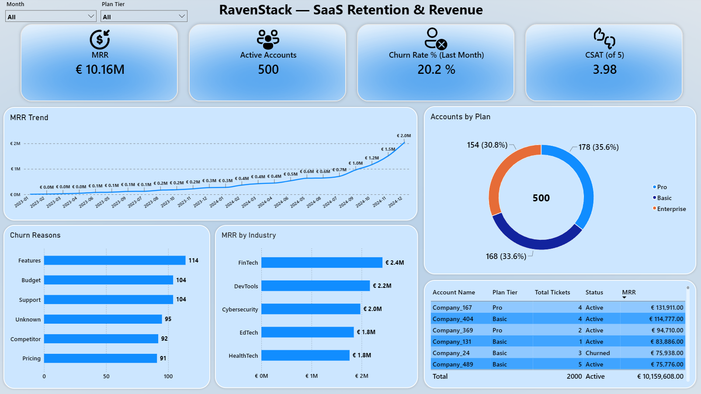
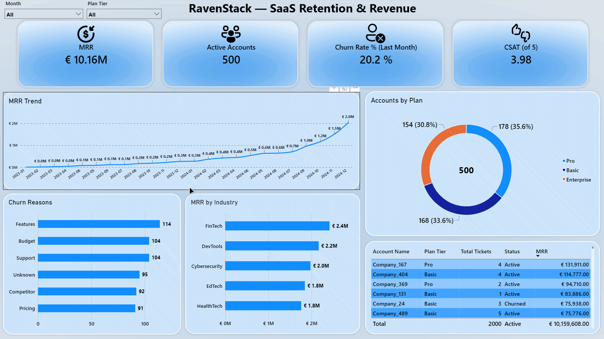
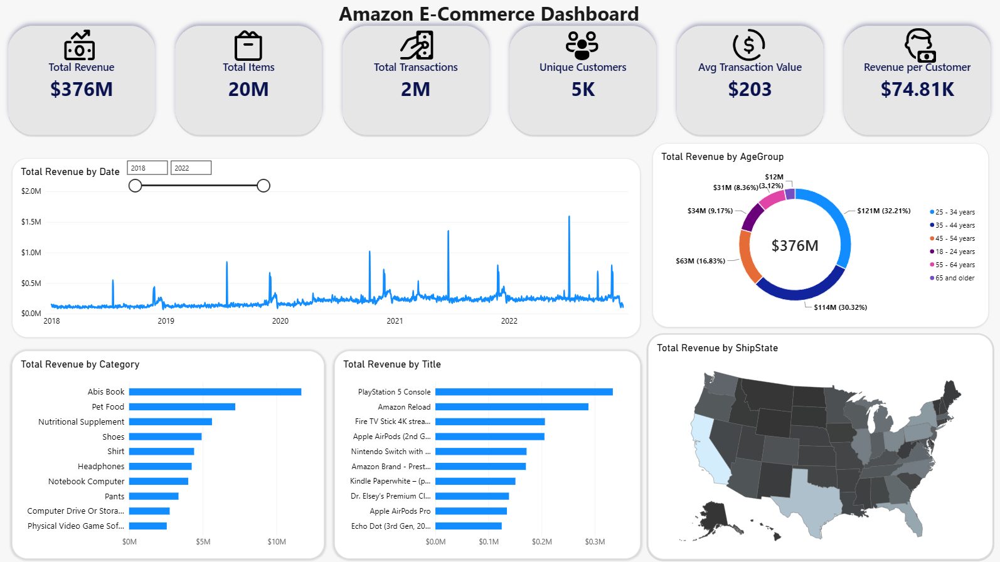
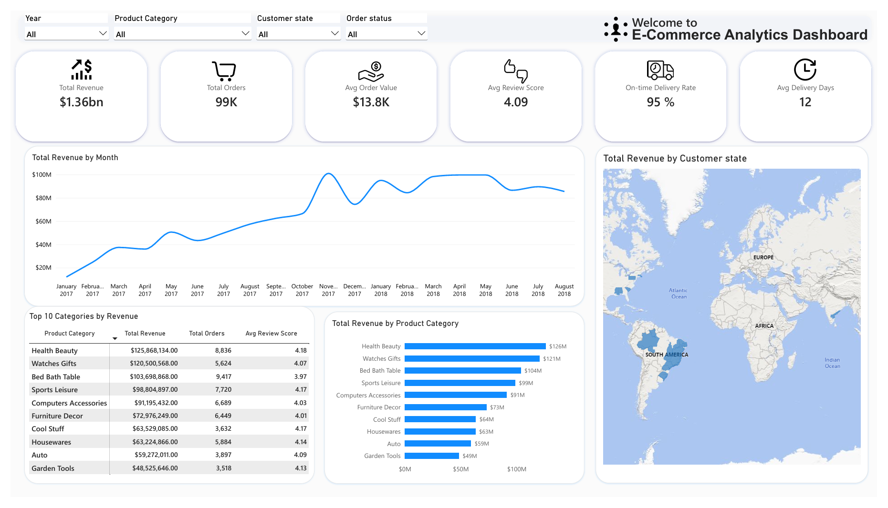
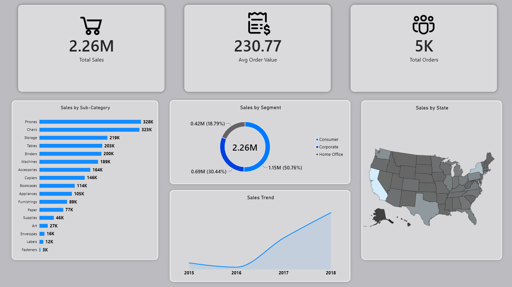
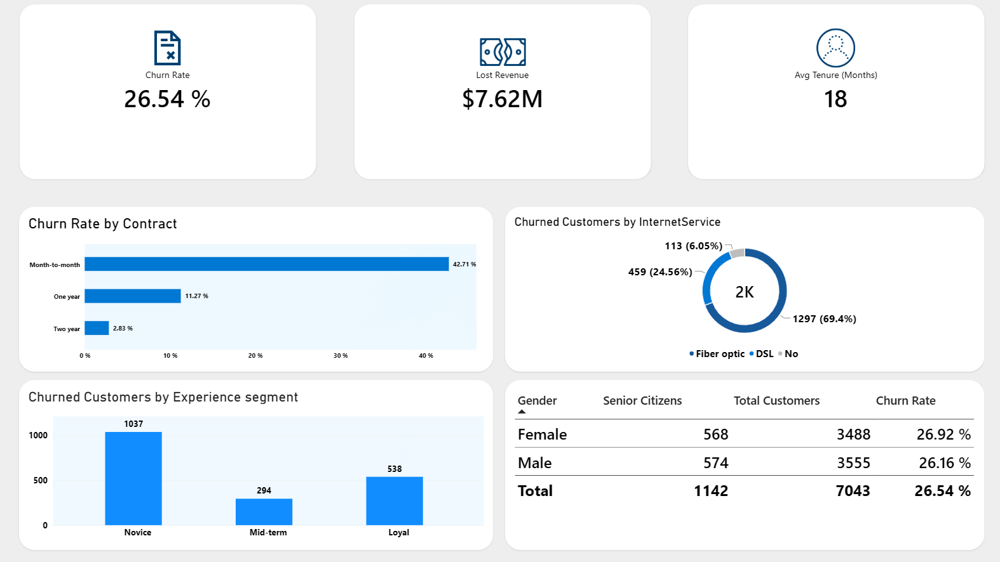
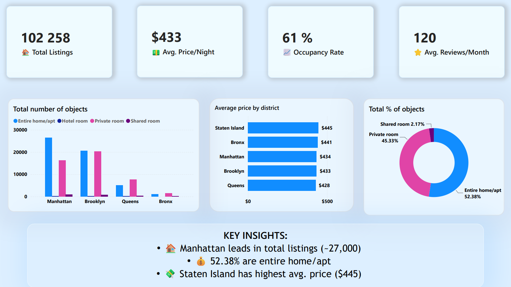
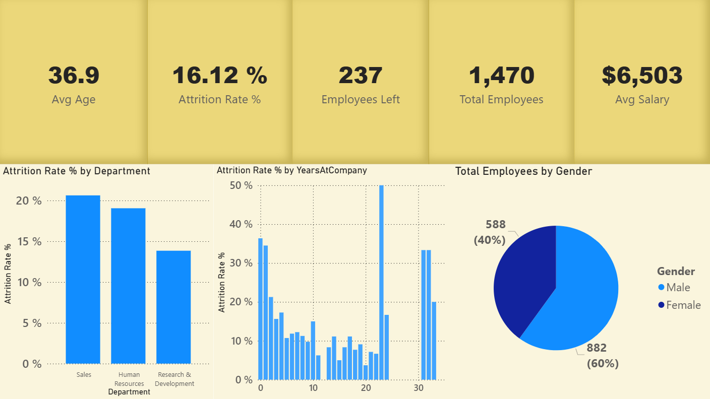
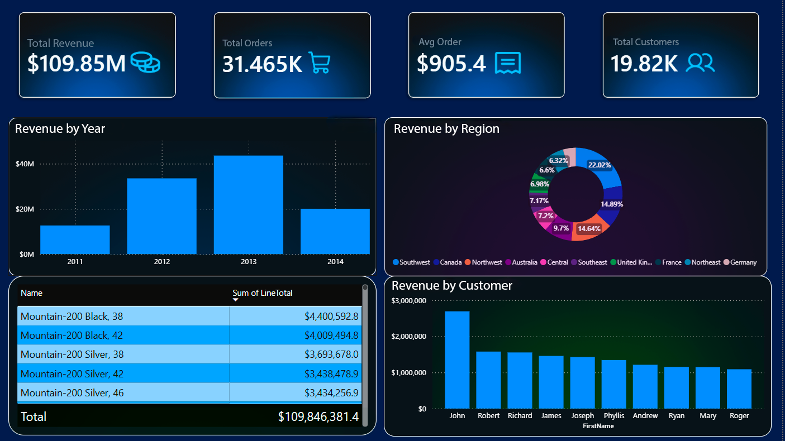
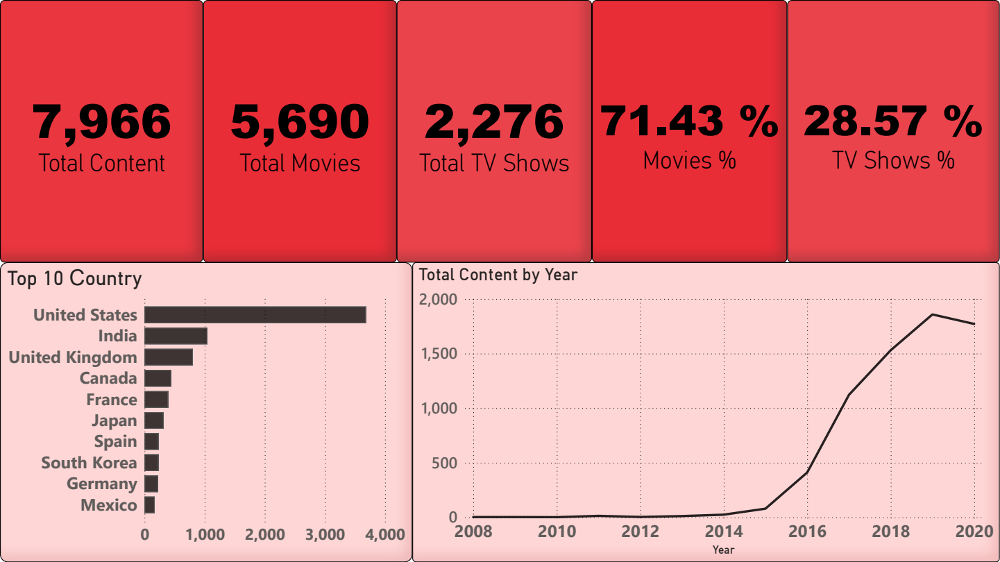

# 📈 RavenStack — SaaS Retention & Revenue Dashboard
##### [← Назад к портфолио](../README_RU.md) | [Switch to English](README.md)



## О проексе

Дашборд в Power BI для анализа выручки и удержания B2B SaaS, построенный на реляционной модели из 5 таблиц (star schema): выручка по подпискам, причины оттока, качество поддержки и детализация по аккаунтам.

### 🎯 Бизнес-задача

**Контекст:** RavenStack — B2B SaaS-платформа: 500 клиентских аккаунтов, 5 000 записей о подписках, 25 000 событий использования фич, 2 000 тикетов в поддержку и 600 событий оттока за 2023–2025. Месячная выручка растёт (MRR €10.16M), при этом месячный отток составляет 20.2% (декабрь 2024), а через отток за весь период прошли 352 из 500 аккаунтов (70%) — компания растёт за счёт привлечения, а не удержания.
**Задача:** одно окно мониторинга удержания, отвечающее на вопросы:

- Какова база выручки (MRR) и как она меняется по месяцам?
- Сколько аккаунтов уходит за месяц и по каким причинам?
- Какие тарифы и индустрии дают выручку?
- Хорошо ли мы обслуживаем клиентов — какой у нас CSAT?

**Бизнес-ценность:** Рост выручки скрывает утечку в удержании. MRR и отток на одном экране делают этот разрыв видимым, а не прячут за одной удобной цифрой.

## 🛠️ Инструменты

- Power BI Desktop
- DAX
- Power Query
- CSV (5 исходных таблиц)

## Что я сделал

### 1. Подготовка данных

- Свёл 5 CSV в модель с бизнес-именами: `Accounts` (500), `Subscriptions` (5 000), `FeatureUsage` (25 000), `SupportTickets` (2 000), `ChurnEvents` (600).
- Починил поломку локали на уровне источника: десятичные колонки (`satisfaction_score`, `resolution_time_hours`, `mrr_amount`, `refund_amount_usd`) переимпортированы через **Changed Type with Locale** (en-US) — сломанная метрика CSAT превратилась в реальные **3.98 / 5**.
- Обезвредил классическую ловушку MRR: `Subscriptions` — это история смен плана (~10 строк на аккаунт), поэтому обычный `SUM(mrr_amount)` посчитал бы каждого клиента ~10 раз. Пустые `end_date` заменил sentinel-датой `#date(2099,12,31)`, чтобы открытые активные подписки оставались фильтруемыми по периоду.
- Обезличил клиентов в Power Query: исходные названия компаний заменены на `Company_1 … Company_500` через колонку-индекс (`"Company_" & Text.From(Index)`).
- Чистка `ChurnEvents`: пустой `feedback_text` → `No feedback`; `reason_code` приведён к виду через `Text.Proper` для читаемых полос.
- Переименования в бизнес-язык (`plan_tier` → `Plan Tier`, `account_name` → `Account Name`) сделаны в Data pane / Model view, а не в M; сырая колонка `churn_flag` пользователям отчёта не показывалась.

### 2. Модель данных

**Star schema:** измерение `Accounts` и календарная таблица на DAX `DimDate` (`CALENDAR(2023-01-01, 2025-12-31)` с Year / Month / Quarter / IsCurrentMonth); факты `Subscriptions`, `FeatureUsage`, `SupportTickets`, `ChurnEvents`. Связи `Accounts → SupportTickets / ChurnEvents / Subscriptions` активные 1-to-many по `account_id`; `FeatureUsage` привязан к аккаунтам через `subscription_id`. Все меры в отдельной таблице `_Measures`.

### 3. DAX-меры

**MRR** — рекуррентная выручка подписок, активных на конец выбранного периода:

```dax
MRR =
CALCULATE (
    SUM ( 'Subscriptions'[mrr_amount] ),
    FILTER (
        'Subscriptions',
        'Subscriptions'[start_date] <= MAX ( 'DimDate'[Date] )
            && 'Subscriptions'[end_date] >= MAX ( 'DimDate'[Date] )
    )
)
```

**Active Accounts**

```dax
Active Accounts =
CALCULATE(
    DISTINCTCOUNT('Subscriptions'[account_id]),
    FILTER(
        'Subscriptions',
        'Subscriptions'[start_date] <= MAX('DimDate'[Date]) &&
        'Subscriptions'[end_date] >= MAX('DimDate'[Date])
    )
)
```

**Churn Rate % (Last Month)** — месячный отток: ушедшие за выбранный месяц, делённые на активные на 1-е число этого месяца. Если выбран пустой период, мера откатывается на последний месяц с данными (декабрь 2024):

```dax
Churn Rate % (Last Month) = 
VAR MaxDateCtx = MAX ( 'DimDate'[Date] )
VAR CtxStart = EOMONTH ( MaxDateCtx, -1 ) + 1
VAR CtxEnd = EOMONTH ( MaxDateCtx, 0 )
VAR ChurnedCtx =
    CALCULATE (
        DISTINCTCOUNT ( 'ChurnEvents'[account_id] ),
        REMOVEFILTERS ( 'DimDate' ),
        'ChurnEvents'[churn_date] >= CtxStart,
        'ChurnEvents'[churn_date] <= CtxEnd
    )
VAR MaxChurnDate =
    CALCULATE ( MAX ( 'ChurnEvents'[churn_date] ), ALL ( 'DimDate' ) )
VAR LastStart = EOMONTH ( MaxChurnDate, -1 ) + 1
VAR LastEnd = EOMONTH ( MaxChurnDate, 0 )
VAR UseFallback = ISBLANK ( ChurnedCtx ) || ChurnedCtx = 0
VAR MonthStart = IF ( UseFallback, LastStart, CtxStart )
VAR Churned =
    IF (
        UseFallback,
        CALCULATE (
            DISTINCTCOUNT ( 'ChurnEvents'[account_id] ),
            REMOVEFILTERS ( 'DimDate' ),
            'ChurnEvents'[churn_date] >= LastStart,
            'ChurnEvents'[churn_date] <= LastEnd
        ),
        ChurnedCtx
    )
VAR ActiveStart =
    CALCULATE (
        DISTINCTCOUNT ( 'Subscriptions'[account_id] ),
        FILTER (
            ALL ( 'Subscriptions' ),
            'Subscriptions'[start_date] <= MonthStart &&
            'Subscriptions'[end_date] >= MonthStart
        )
    )
RETURN
    DIVIDE ( Churned, ActiveStart, 0 )
```

**Churn Count by Reason**

```dax
Churn Count by Reason = COUNTROWS ( 'ChurnEvents' )
```

**Status** — читаемый статус аккаунта вместо TRUE/FALSE:

```dax
Status =
VAR Flag = SELECTEDVALUE ( 'Accounts'[churn_flag] )
RETURN
    IF ( Flag = TRUE, "Churned", "Active" )
```

**CSAT (of 5)**

```dax
CSAT (of 5) = AVERAGE ( 'SupportTickets'[satisfaction_score] )
```

**Total Tickets**

```dax
Total Tickets = COUNTROWS ( 'SupportTickets' )
```

**Avg Resolution Hours** — среднее время решения тикета, в модели для per-account анализа качества сервиса:

```dax
Avg Resolution Hours = AVERAGE ( 'SupportTickets'[resolution_time_hours] )
```

**Escalation Rate %** — доля тикетов с эскалацией, в модели для per-account анализа риска ухода:

```dax
Escalation Rate % = 
VAR Escalated =
    CALCULATE (
        COUNTROWS ( 'SupportTickets' ),
        FILTER (
            'SupportTickets',
            LOWER ( TRIM ( 'SupportTickets'[escalation_flag] & "" ) )
                IN { "1", "true", "yes", "y", "t", "escalated" }
        )
    )
VAR Total = COUNTROWS ( 'SupportTickets' )
RETURN
    IF ( ISBLANK ( Total ) || Total = 0, DIVIDE ( Escalated, Total ) )
```

**Total Refunds** — сумма возвратов по событиям оттока, в модели для per-account анализа потерь:

```dax
Total Refunds = SUM ( 'ChurnEvents'[refund_amount_usd] )
```

### 4. Визуализация

- **KPI-карточки** — MRR (€10.16M), Active Accounts (500), Churn Rate % (Last Month) — 20.2%, CSAT (of 5) — 3.98, с иконками.
- **Line chart** — тренд MRR по месяцам (`DimDate`).
- **Donut** — аккаунты по тарифам: Pro 178 (35.6%), Basic 168 (33.6%), Enterprise 154 (30.8%).
- **Bar chart** — причины оттока: Features 114, Support 104, Budget 104, Unknown 95, Competitor 92, Pricing 91.
- **Bar chart** — MRR по индустриям (Top 5): FinTech €2.4M, DevTools €2.2M, Cybersecurity €2.0M, EdTech €1.8M, HealthTech €1.8M.
- **Таблица клиентов** — Account Name, Plan Tier, Total Tickets, MRR, Status.
- **Слайсеры** — Month и Plan Tier, оба в режиме выпадающего списка.

### 5. Дизайн

- Единый акцентный синий на KPI-карточках с мягким градиентом и одним набором иконок.
- Подписи на экране в бизнес-языке: `CSAT (of 5)` сохраняет шкалу, `Churn Rate % (Last Month)` называет окно измерения, имён колонок вида `plan_tier` в заголовках нет.
- Переименованные поля и очищенные значения `reason_code` убрали все подчёркивания из слоя отчёта.
- Каждый визуал отвечает на один из бизнес-вопросов.



## Применённые навыки

- Power Query: типизация с локалью, sentinel-даты для открытых подписок, анонимизация через индекс, чистка NULL, `Text.Proper`
- Моделирование star schema с календарной таблицей на DAX
- DAX: `CALCULATE` / `FILTER` / `DISTINCTCOUNT` / `SELECTEDVALUE` / `EOMONTH` / `REMOVEFILTERS` / `DIVIDE` 
- Управление контекстом фильтра: `ALL('Subscriptions')` в знаменателе, чтобы фильтр месяца не утекал в подписки; `REMOVEFILTERS('DimDate')` для расчёта окна вне текущего среза
- Валидация метрик: карточка MRR сведена к итогу таблицы €10 159 608, CSAT перепроверен после locale-фикса, месячный отток сведён к 96 из 476 активных на 1 декабря = 20.2%
- UI дизайн дашбордов и оптимизация визуалов

## 📈 Ключевые инсайты

- **Рост держится на привлечении; утечка — в удержании.** Растущий MRR соседствует с 20.2% месячного оттока и 70% накопленного оттока по модели (352 из 500 аккаунтов имеют событие в `ChurnEvents`; 110 помечены `churn_flag` как ушедшие сейчас) — центральный вывод отчёта.
- **Причины оттока плоские, без единого виновника:** Features 114, Support 104, Budget 104, Unknown 95, Competitor 92, Pricing 91. При такой близости цифр продуктовая поверхность весит больше, чем цена.
- **Тарифы распределены поровну** (Pro 35.6% / Basic 33.6% / Enterprise 30.8%), поэтому сам тариф историю оттока не объясняет.
- **Выручка сконцентрирована в трёх индустриях:** FinTech, DevTools и Cybersecurity держат ~€6.5M из €10.16M, поэтому кластер уходов в любой из них двигает MRR непропорционально.
- **Качество сервиса стабильное:** CSAT 3.98 / 5 при 2 000 тикетах — при такой оценке уход не выглядит следствием плохой поддержки, значит искать причину нужно в продукте и цене.

## 💡 Рекомендации

1. **Закрыть пробел в атрибуции:** `Unknown` (95 из 600 событий) — каждый шестой уход не объяснён. Без причины нельзя ни удержать клиента, ни понять, куда вкладываться в продукт. Выходные интервью или win-back звонки закроют этот бакет.
2. **Считать приток против оттока:** 20.2% месячного оттока при базе 476 активных на 1 декабря — это 96 уходов за месяц. Чтобы просто удержать базу в 500 аккаунтов, привлечение должно закрывать минимум 96 подписок ежемесячно: оно должно опережать утечку, а не догонять её.
3. **Приоритет причин — продукт, а не цена:** Features (114) обгоняют Support (104) и Pricing (91). Скидка влияет на цену, а продукт — на сам факт ухода, поэтому закрывать продуктовые пробелы первыми.
4. **Защитить ядро выручки:** 64% MRR в трёх индустриях (FinTech, DevTools, Cybersecurity) — усилия по удержанию стоит начинать оттуда, а не распределять равномерно.

## 📂 Датасет

Портфолио-проект на публичном датасете RavenStack (симуляция B2B SaaS: аккаунты, подписки, использование фич, тикеты, отток — 5 CSV-таблиц), оформленный как реальная задача анализа выручки и удержания.

**Источник:** [Kaggle: SaaS Subscription & Churn Analytics Dataset](https://www.kaggle.com/datasets/rivalytics/saas-subscription-and-churn-analytics-dataset)

**Файл:** [📥 Скачать .pbix](https://raw.githubusercontent.com/Mangil123123/portfolio/main/RavenStack/Files/RavenStack.pbix) (итоговый отчёт, для просмотра понадобится бесплатная программа Power BI Desktop)

**Затрачено времени:** 6 дней

## 🗂️ Другие проекты

| | | |
|---|---|---|
| <a href="../Amazon_Ecommerce/README_RU.md"></a> | <a href="../Olist_Ecommerce/README_RU.md"></a> | <a href="../Superstore/README_RU.md"></a> |
| **Amazon E-Commerce** | **Olist E-Commerce** | **Superstore** |
| Аналитика маркетплейса США | Бразильский e-commerce | Ритейл-аналитика |

| | | |
|---|---|---|
| <a href="../Telco_Churn/README_RU.md"></a> | <a href="../Airbnb_NYC/README_RU.md"></a> | <a href="../HR_Employee_Attrition/README_RU.md"></a> |
| **Telco Churn** | **Airbnb NYC** | **HR Analytics** |
| Отток клиентов телекома | Рынок аренды | Текучесть персонала |

| | |
|---|---|
| <a href="../AdventureWorks_Sales_Dashboard/README_RU.md"></a> | <a href="../Netflix_analysis/README_RU.md"></a> |
| **AdventureWorks Sales** | **Netflix Analysis** |
| Розничные продажи и дистрибуция | Анализ контента Netflix |

[← Назад к портфолио](../README_RU.md)
